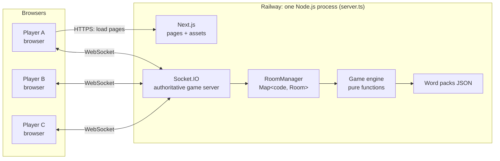
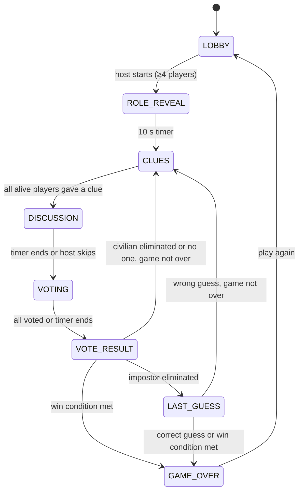

# Choddobeshi: Online Social Deduction Word Game

A complete guide to designing, building and deploying the game: rules, tech stack, architecture, code skeletons, build plan, enhancements and a player rulebook.

---

## Table of Contents

1. [Game Overview](#1-game-overview)
2. [Complete Rules (Design Spec)](#2-complete-rules-design-spec)
3. [Recommended Tech Stack](#3-recommended-tech-stack)
4. [Architecture](#4-architecture)
5. [Game State Machine](#5-game-state-machine)
6. [Data Model](#6-data-model)
7. [Network Events (Client ↔ Server)](#7-network-events-client--server)
8. [Core Server Logic (Code Skeletons)](#8-core-server-logic-code-skeletons)
9. [Client Screens](#9-client-screens)
10. [Word Packs](#10-word-packs)
11. [Anti-Cheat and Fairness](#11-anti-cheat-and-fairness)
12. [Step-by-Step Build Plan](#12-step-by-step-build-plan)
13. [Testing](#13-testing)
14. [Deployment](#14-deployment)
15. [Enhancements](#15-enhancements)
16. [Player Rulebook (Share With Friends)](#16-player-rulebook-share-with-friends)

---

## 1. Game Overview

| | |
|---|---|
| **Genre** | Social deduction + word association |
| **Players** | 4 to 12 (best with 6 to 8) |
| **Game length** | 10 to 20 minutes |
| **Platform** | Web browser (phone or desktop), no install |
| **Voice** | Optional. Play over Discord / Google Meet, or use built-in text chat |
| **Stack** | Next.js + TypeScript + Socket.IO in **one** app |
| **Hosting** | **One Railway service** runs both the website and the game server |

### The three roles

| Role | Gets | Knows their role? | Goal |
|---|---|---|---|
| **Civilian** | The secret word (e.g. `Coffee`) | No, only sees the word | Find and vote out every Doppelganger and Chameleon |
| **Doppelganger** | A *similar* word (e.g. `Tea`) | **No.** Thinks they are a Civilian | Survive, or guess the Civilians' word when caught |
| **Chameleon** | Nothing | **Yes.** Sees "You are the Chameleon" | Blend in, survive, or guess the Civilians' word when caught |

The twist: the Doppelganger receives a word just like everyone else, so they play honestly and believe they are a Civilian. Only as the clues pile up might they notice their word is slightly different from everyone else's. Then they must decide: keep quiet and blend in, or accuse others.

---

## 2. Complete Rules (Design Spec)

These are the exact rules the code should enforce. Items marked **(setting)** should be configurable by the host.

### 2.1 Role distribution

Civilians must always outnumber the impostors (Doppelgangers + Chameleons) at the start.

| Players | Civilians | Doppelgangers | Chameleons |
|---|---|---|---|
| 4 | 3 | 1 *or* 0 | 0 *or* 1 (random) |
| 5 | 3 | 1 | 1 |
| 6 | 4 | 1 | 1 |
| 7 | 5 | 1 | 1 |
| 8 | 5 | 2 | 1 |
| 9 | 6 | 2 | 1 |
| 10 | 6 | 2 | 2 |
| 11 | 7 | 2 | 2 |
| 12 | 8 | 2 | 2 |

Host can override counts **(setting)**, as long as civilians > impostors.

### 2.2 Game flow

1. **Lobby:** Players join a room with a 4-letter code. Host presses Start.
2. **Role reveal:** Each player privately sees their card:
   - Civilian and Doppelganger see: *"Your word is: **Coffee**"* (no role label).
   - Chameleon sees: *"You are the **Chameleon**. You have no word. Blend in."*
3. **Clue phase:** Players take turns in a random order. Each player gives **one word** that relates to their secret word. Each turn has a timer (default 30 s **(setting)**).
4. **Discussion phase:** Free discussion (default 60 s **(setting)**). Players argue about who seems suspicious.
5. **Voting phase:** Every alive player votes for one player or **Skip** (default 30 s **(setting)**). Votes are hidden until everyone has voted or the timer ends.
6. **Vote result:**
   - The player with the **most votes** is eliminated.
   - If **Skip** has the most votes, or there is a **tie** for first place, **nobody** is eliminated.
   - Players who did not vote count as Skip.
7. **Ejection reveal:**
   - If a **Civilian** is eliminated: their role is revealed **(setting: reveal / hide)** and they become a ghost (spectator). Game continues.
   - If a **Doppelganger or Chameleon** is eliminated: they enter the **Last Guess**.
8. **Last Guess:** The caught impostor has 30 seconds to type the Civilians' word.
   - **Correct:** That player **wins the game** immediately.
   - **Wrong:** They become a ghost. Game continues.
   - A Doppelganger learns they were the Doppelganger at this moment.
9. **Next round:** Return to step 3 with the remaining players. Clues may not repeat words already said.

### 2.3 Win conditions

Check these after every vote result and every Last Guess, in this order:

| Condition | Winner |
|---|---|
| A caught impostor guesses the word correctly | **That impostor** |
| All Doppelgangers and Chameleons are eliminated (all guesses wrong) | **Civilians** |
| Alive impostors ≥ alive Civilians | **Impostors** (all of them, alive or dead, who did not already lose) |
| Max rounds reached (this max round condition should be based on the player playing the game **(setting)**) and impostors still alive | **Impostors** |

> **Design note:** Your original rule only covers "impostor found out". Without the parity and round-limit rules, a game where civilians keep voting wrong or skipping could go on forever. The two extra rules fix that.

### 2.4 Clue rules

- Exactly one word (hyphenated words count as one, e.g. `ice-cream`). **(setting: allow up to 2 words)**
- Not the secret word itself, a part of it, a translation of it, or an obvious spelling of it.
- Not a word already said by anyone in this game.
- The server auto-rejects: empty clues, multi-word clues, exact repeats, and the player's own secret word.

### 2.5 Speaking order

- Random order each match(throughout the whole match this order is followed).
- The **Chameleon never speaks first in Round 1** but they can be 2nd one to speak(they would have zero information, which is unfair).

### 2.6 Guess matching

A guess is correct if, after normalizing (lowercase, trim, remove punctuation, Unicode NFC), it:
- equals the civilian word, or
- equals one of the word's listed aliases (`"tv"` for `"television"`), or
- is within 1 typo (Levenshtein distance ≤ 1) for words longer than 4 letters, or
- the host clicks **Accept** within 10 seconds (manual override for synonyms).

---

## 3. Recommended Tech Stack

### 3.1 Recommended: one Next.js app with Socket.IO, on Railway

Everything lives in **one project, one process, one deploy, one URL**.

| Layer | Choice | Why |
|---|---|---|
| Language | **TypeScript** | Used everywhere: pages, game logic, server. Types are shared with no extra setup. |
| Framework | **Next.js (App Router)** | React UI plus routing, so join links like `/room/QXZT` work out of the box. |
| Styling | **Tailwind CSS** | Quick to build mobile-first UI. Comes with `create-next-app`. |
| Realtime | **Socket.IO** | Rooms, auto-reconnect, fallbacks. Made for exactly this. |
| Server | **Next.js custom server** (`server.ts`) | One Node process starts Next.js *and* Socket.IO on the same port. |
| Storage | **In-memory** (`Map`) to start | A party game does not need a database. Add Redis later if needed. |
| Validation | **Zod** | Validate every message from clients. |
| Testing | **Vitest** | Unit-test the game logic without a browser. |
| Hosting | **Railway** (one service) | Runs a normal long-lived Node process, so WebSockets, room memory and timers all work. |

> **TypeScript vs Next.js:** these are not alternatives. TypeScript is the language. Next.js is the framework. This project uses both.

### Why one Railway service, and not Vercel

The game needs a server that **stays running**: it holds every player's live connection, keeps rooms in memory and runs phase timers.

- **Vercel** runs Next.js server code as short-lived functions. They cannot keep WebSocket connections, room memory or timers. On Vercel, only the website part would work.
- **Railway** (also Render or Fly.io) runs your app as a normal long-running Node process. The website and the game server run together in one place, so the whole game works.

Running Next.js through a custom server means a few Vercel-specific extras (edge functions, CDN-level ISR) are unavailable. A party game does not need them.

### 3.2 Alternatives

| Option | When to pick it |
|---|---|
| **Colyseus** (Node game-server framework) | You want built-in room management, state sync and matchmaking. More to learn. |
| **PartyKit / Cloudflare Durable Objects** | You want serverless-style hosting with one stateful object per room. |
| **Firebase Realtime DB / Supabase Realtime** | You want no server at all. Harder to keep secret words secret, because the game logic runs in clients. Not recommended for this game. |
| **Everything on Vercel + Pusher/Ably + Upstash Redis** | Only if you must use Vercel. Room state goes to Redis on every action, timers must be checked on each request, and each player needs a private channel for their word. Much more complex. |
| **Godot / Unity** | You want a native app with animations. Much more work for a word game. |

### 3.3 Prerequisites to learn (if new)

1. JavaScript/TypeScript basics.
2. React components, state, `useEffect`.
3. Next.js App Router: `page.tsx`, `layout.tsx`, dynamic routes (`[code]`), `"use client"`.
4. Socket.IO: `emit`, `on`, rooms. The official "chat app" tutorial covers 80% of what you need. Socket.IO's own "How to use with Next.js" guide shows the exact custom-server setup used here.

---

## 4. Architecture



Both Next.js and Socket.IO listen on the **same port and domain**, so the browser connects to the game with `io()` and no URL. There is no CORS setup and only one deploy.

### Key principle: the server is the only source of truth

- The server picks roles and words, runs timers, counts votes and checks guesses.
- Clients only **send intents** (`submitClue`, `vote`, `guess`) and **render state** the server sends.
- Each client receives a **personalized view**. A player never receives anyone else's word or role. This is the most important anti-cheat rule: if a secret is never sent to the browser, it cannot be found in DevTools.

### Project structure

One Next.js project. No monorepo needed.

```
choddobeshi/
├── package.json
├── server.ts                     # custom server: starts Next.js + Socket.IO together
├── next.config.ts
├── tsconfig.json
└── src/
    ├── app/                      # Next.js pages (UI only)
    │   ├── layout.tsx
    │   ├── page.tsx              # Home: name, create room, join room
    │   ├── how-to-play/page.tsx  # Rulebook (section 16)
    │   └── room/[code]/page.tsx  # Lobby + whole game, switches screen by phase
    ├── components/
    │   └── screens/
    │       ├── Lobby.tsx
    │       ├── RoleReveal.tsx
    │       ├── Clue.tsx
    │       ├── Discussion.tsx
    │       ├── Voting.tsx
    │       ├── Ejection.tsx
    │       ├── LastGuess.tsx
    │       └── GameOver.tsx
    ├── lib/
    │   └── socket.ts             # browser Socket.IO client
    ├── shared/
    │   ├── types.ts              # Player, Room, Phase, events (used by both sides)
    │   └── schemas.ts            # Zod schemas for client messages
    └── server/                   # game server code: never imported by pages
        ├── rooms.ts              # create/join/leave/reconnect, socket handlers
        ├── game/
        │   ├── engine.ts         # phase transitions (pure functions)
        │   ├── roles.ts          # role assignment
        │   ├── votes.ts          # vote tally
        │   ├── guess.ts          # guess normalization + matching
        │   └── view.ts           # build per-player view (hides secrets)
        ├── words/
        │   ├── en.json
        │   └── bn.json
        └── __tests__/
```

> **Rule:** files in `src/app` and `src/components` must never import from `src/server`. Otherwise the word lists end up in the browser bundle, where anyone can read them.

---

## 5. Game State Machine



Every transition happens **on the server**. Each phase stores `phaseEndsAt` (a timestamp) so clients can show a countdown, and the server uses `setTimeout` to advance when it expires.

---

## 6. Data Model

```ts
// src/shared/types.ts
export type Role = "civilian" | "doppelganger" | "chameleon";

export type Phase =
  | "LOBBY" | "ROLE_REVEAL" | "CLUES" | "DISCUSSION"
  | "VOTING" | "VOTE_RESULT" | "LAST_GUESS" | "GAME_OVER";

export interface Player {
  id: string;            // stable id stored in localStorage (survives refresh)
  socketId: string | null;
  name: string;
  isHost: boolean;
  connected: boolean;
  alive: boolean;
  role?: Role;           // server only
  word?: string | null;  // server only
}

export interface Clue { playerId: string; round: number; text: string }

export interface Settings {
  clueSeconds: number;        // 30
  discussionSeconds: number;  // 60
  voteSeconds: number;        // 30
  guessSeconds: number;       // 30
  maxRounds: number;          // 6 (6 to 10)
  revealRoleOnEject: boolean; // true
  doppelgangers: number | "auto";
  chameleons: number | "auto";
  wordPack: string;           // "en-general"
}

export interface Room {
  code: string;                       // "QXZT"
  players: Player[];
  settings: Settings;
  phase: Phase;
  phaseEndsAt: number | null;
  round: number;
  civilianWord: string;
  doppelgangerWord: string;
  turnOrder: string[];                // player ids for current round
  turnIndex: number;
  clues: Clue[];
  votes: Record<string, string | "skip">; // voterId -> targetId | "skip"
  lastEliminated: string | null;
  winner: null | { team: "civilians" | "impostors" | "guesser"; playerIds: string[] };
  timer?: NodeJS.Timeout;             // server only
}

// What one client is allowed to see
export interface PlayerView {
  me: { id: string; word: string | null; isChameleon: boolean; alive: boolean };
  room: Omit<Room, "players" | "civilianWord" | "doppelgangerWord" | "votes" | "timer"> & {
    players: Array<Pick<Player, "id" | "name" | "isHost" | "connected" | "alive"> & {
      revealedRole?: Role;  // only for eliminated players if revealRoleOnEject
      hasVoted?: boolean;   // during VOTING
    }>;
    voteTally?: Record<string, number>; // only in VOTE_RESULT
  };
}
```

Note `me` has **no `role` field** for Civilians and Doppelgangers. Only `isChameleon`. This is what keeps the Doppelganger unaware.

---

## 7. Network Events (Client ↔ Server)

### Client → Server

| Event | Payload | Allowed in phase |
|---|---|---|
| `room:create` | `{ name }` | any |
| `room:join` | `{ code, name, playerId? }` | LOBBY (or rejoin any phase) |
| `room:settings` | `Partial<Settings>` | LOBBY, host only |
| `game:start` | `{}` | LOBBY, host only |
| `clue:submit` | `{ text }` | CLUES, only current speaker |
| `discussion:skip` | `{}` | DISCUSSION, host only |
| `vote:cast` | `{ target: playerId \| "skip" }` | VOTING, alive players |
| `guess:submit` | `{ text }` | LAST_GUESS, only eliminated impostor |
| `guess:accept` | `{}` | LAST_GUESS, host only (synonym override) |
| `chat:send` | `{ text }` | any (ghosts chat only with ghosts) |
| `game:again` | `{}` | GAME_OVER, host only |

### Server → Client

| Event | Payload |
|---|---|
| `state` | `PlayerView` (sent after every change, personalized per player) |
| `error` | `{ message }` (e.g. "Clue already used") |
| `chat` | `{ from, text, ghost }` |

Sending the full personalized `state` after every change is simpler and less buggy than sending small diffs. Payloads are tiny, so performance is not a concern.

---

## 8. Core Server Logic (Code Skeletons)

### 8.1 Custom server: Next.js + Socket.IO in one process

```ts
// server.ts (project root)
import { createServer } from "node:http";
import next from "next";
import { Server } from "socket.io";
import { registerHandlers } from "./src/server/rooms";

const dev = process.env.NODE_ENV !== "production";
const port = Number(process.env.PORT ?? 3000); // Railway sets PORT
const app = next({ dev, port });
const handle = app.getRequestHandler();

app.prepare().then(() => {
  const httpServer = createServer(handle);          // Next.js serves all pages
  const io = new Server(httpServer, {
    destroyUpgrade: false,                           // leave Next.js dev hot-reload websocket alone
  });
  io.on("connection", (socket) => registerHandlers(io, socket));
  httpServer.listen(port, () => console.log(`Ready on port ${port}`));
});
```

### 8.2 Browser socket client

```ts
// src/lib/socket.ts
"use client";
import { io } from "socket.io-client";

// No URL: connects to the same domain that served the page
export const socket = io({ autoConnect: false });
```

```tsx
// src/app/room/[code]/page.tsx
"use client";
import { use, useEffect, useState } from "react";
import { socket } from "@/lib/socket";
import type { PlayerView } from "@/shared/types";

export default function RoomPage({ params }: { params: Promise<{ code: string }> }) {
  const { code } = use(params);
  const [view, setView] = useState<PlayerView | null>(null);

  useEffect(() => {
    const playerId = localStorage.getItem("playerId") ?? crypto.randomUUID();
    localStorage.setItem("playerId", playerId);
    const name = localStorage.getItem("name") ?? "Player";

    socket.on("state", setView);
    socket.on("connect", () => socket.emit("room:join", { code, name, playerId })); // also runs on reconnect
    socket.connect();
    return () => { socket.off("state", setView); socket.off("connect"); socket.disconnect(); };
  }, [code]);

  if (!view) return <p>Connecting…</p>;
  switch (view.room.phase) {
    case "LOBBY": return <Lobby view={view} />;
    case "ROLE_REVEAL": return <RoleReveal view={view} />;
    // ...one screen per phase
  }
}
```

### 8.3 Scripts

```json
// package.json (scripts and the deps that matter)
{
  "scripts": {
    "dev": "tsx server.ts",
    "build": "next build",
    "start": "cross-env NODE_ENV=production tsx server.ts",
    "test": "vitest"
  },
  "dependencies": {
    "next": "latest",
    "react": "latest",
    "react-dom": "latest",
    "socket.io": "^4",
    "socket.io-client": "^4",
    "zod": "^3",
    "tsx": "^4",
    "cross-env": "^7"
  }
}
```

- `tsx` runs `server.ts` directly with no separate compile step. It sits in `dependencies` (not `devDependencies`) because production needs it.
- `cross-env` makes `NODE_ENV=production` work on Windows as well as Linux.
- In dev, Next.js hot-reloads pages on save. After editing files in `src/server/`, stop and re-run `npm run dev`.

### 8.4 Role assignment

```ts
// src/server/game/roles.ts
export function defaultCounts(n: number) {
  if (n === 4) return Math.random() < 0.5 ? { d: 1, c: 0 } : { d: 0, c: 1 };
  if (n <= 7) return { d: 1, c: 1 };
  if (n <= 9) return { d: 2, c: 1 };
  return { d: 2, c: 2 };
}

function shuffle<T>(arr: T[]): T[] {
  const a = [...arr];
  for (let i = a.length - 1; i > 0; i--) {
    const j = Math.floor(Math.random() * (i + 1));
    [a[i], a[j]] = [a[j], a[i]];
  }
  return a;
}

export function assignRoles(room: Room, pair: { civilian: string; doppelganger: string }) {
  const { d, c } = defaultCounts(room.players.length);
  if (d + c >= room.players.length - (d + c)) throw new Error("Too many impostors");

  const shuffled = shuffle(room.players);
  shuffled.forEach((p, i) => {
    p.alive = true;
    if (i < d)          { p.role = "doppelganger"; p.word = pair.doppelganger; }
    else if (i < d + c) { p.role = "chameleon";    p.word = null; }
    else                { p.role = "civilian";     p.word = pair.civilian; }
  });
  room.civilianWord = pair.civilian;
  room.doppelgangerWord = pair.doppelganger;
}
```

### 8.5 Turn order (Chameleon never first in round 1)

```ts
export function makeTurnOrder(room: Room): string[] {
  const alive = shuffle(room.players.filter(p => p.alive));
  if (room.round === 1 && alive[0]?.role === "chameleon") {
    const swap = alive.findIndex(p => p.role !== "chameleon");
    [alive[0], alive[swap]] = [alive[swap], alive[0]];
  }
  return alive.map(p => p.id);
}
```

### 8.6 Clue validation

```ts
export function validateClue(room: Room, player: Player, raw: string): string | null {
  const text = normalize(raw);
  if (!text) return "Clue cannot be empty";
  if (text.split(" ").length > 1) return "One word only";
  if (room.clues.some(c => normalize(c.text) === text)) return "Already used";
  if (player.word && (text === normalize(player.word) || text.includes(normalize(player.word))))
    return "You cannot say your own word";
  return null; // valid
}
```

Note: the "own word" check only blocks the player's own word. It must not reveal anything about the other word, so never check against `room.civilianWord` for a Doppelganger (the error message would leak that the words differ).

### 8.7 Vote tally

```ts
// src/server/game/votes.ts
export function tallyVotes(room: Room): string | null {
  const alive = room.players.filter(p => p.alive);
  const counts: Record<string, number> = { skip: 0 };
  for (const p of alive) {
    const target = room.votes[p.id] ?? "skip"; // no vote = skip
    counts[target] = (counts[target] ?? 0) + 1;
  }
  const max = Math.max(...Object.values(counts));
  const leaders = Object.keys(counts).filter(k => counts[k] === max);
  if (leaders.length > 1 || leaders[0] === "skip") return null; // tie or skip wins
  return leaders[0]; // eliminated player id
}
```

### 8.8 Guess matching

```ts
// src/server/game/guess.ts
export const normalize = (s: string) =>
  s.normalize("NFC").toLowerCase().trim().replace(/[^\p{L}\p{N}\s-]/gu, "").replace(/\s+/g, " ");

function levenshtein(a: string, b: string): number {
  const dp = Array.from({ length: a.length + 1 }, (_, i) => [i, ...Array(b.length).fill(0)]);
  for (let j = 1; j <= b.length; j++) dp[0][j] = j;
  for (let i = 1; i <= a.length; i++)
    for (let j = 1; j <= b.length; j++)
      dp[i][j] = Math.min(dp[i-1][j] + 1, dp[i][j-1] + 1, dp[i-1][j-1] + (a[i-1] === b[j-1] ? 0 : 1));
  return dp[a.length][b.length];
}

export function isCorrectGuess(guess: string, word: string, aliases: string[] = []): boolean {
  const g = normalize(guess);
  const targets = [word, ...aliases].map(normalize);
  return targets.some(t => g === t || (t.length > 4 && levenshtein(g, t) <= 1));
}
```

### 8.9 Win check

```ts
export function checkWinner(room: Room): Room["winner"] {
  const alive = room.players.filter(p => p.alive);
  const impostorsAlive = alive.filter(p => p.role !== "civilian").length;
  const civiliansAlive = alive.length - impostorsAlive;
  const impostorIds = room.players.filter(p => p.role !== "civilian").map(p => p.id);
  const civilianIds = room.players.filter(p => p.role === "civilian").map(p => p.id);

  if (impostorsAlive === 0) return { team: "civilians", playerIds: civilianIds };
  if (impostorsAlive >= civiliansAlive) return { team: "impostors", playerIds: impostorIds };
  if (room.round >= room.settings.maxRounds) return { team: "impostors", playerIds: impostorIds };
  return null;
}
```

Call `checkWinner` after the vote result and after a wrong Last Guess. A correct Last Guess sets `winner = { team: "guesser", playerIds: [id] }` directly.

### 8.10 Personalized view (secret hiding)

```ts
// src/server/game/view.ts
export function viewFor(room: Room, playerId: string): PlayerView {
  const me = room.players.find(p => p.id === playerId)!;
  const over = room.phase === "GAME_OVER";
  return {
    me: { id: me.id, word: me.word ?? null, isChameleon: me.role === "chameleon", alive: me.alive },
    room: {
      code: room.code, phase: room.phase, phaseEndsAt: room.phaseEndsAt, round: room.round,
      settings: room.settings, turnOrder: room.turnOrder, turnIndex: room.turnIndex,
      clues: room.clues, lastEliminated: room.lastEliminated, winner: room.winner,
      players: room.players.map(p => ({
        id: p.id, name: p.name, isHost: p.isHost, connected: p.connected, alive: p.alive,
        revealedRole: over || (!p.alive && room.settings.revealRoleOnEject) ? p.role : undefined,
        hasVoted: room.phase === "VOTING" ? p.id in room.votes : undefined,
      })),
      voteTally: room.phase === "VOTE_RESULT" ? countVotes(room) : undefined,
      // civilianWord is only sent at GAME_OVER
      ...(over && { civilianWord: room.civilianWord, doppelgangerWord: room.doppelgangerWord }),
    },
  };
}

export function broadcast(io: Server, room: Room) {
  for (const p of room.players)
    if (p.socketId) io.to(p.socketId).emit("state", viewFor(room, p.id));
}
```

### 8.11 Reconnection

Players on phones will lose connection when the screen locks. Handle it:

1. On first visit, the client generates `playerId = crypto.randomUUID()` and stores it with the room code in `localStorage`.
2. On reconnect, the client sends `room:join { code, name, playerId }`.
3. The server finds the existing player by `playerId`, updates `socketId`, sets `connected = true` and sends `state`.
4. On `disconnect`, set `connected = false` but **do not remove** the player during a game. Show them greyed out.
5. If the current speaker is disconnected, auto-skip their clue turn when the timer expires.
6. Delete a room when all players have been disconnected for 10 minutes.

---

## 9. Client Screens

**Next.js routes:**

| Route | File | Shows |
|---|---|---|
| `/` | `src/app/page.tsx` | Home screen |
| `/room/QXZT` | `src/app/room/[code]/page.tsx` | Lobby and every in-game screen. One page that switches component by `view.room.phase` (section 8.2), so the socket connection never drops between phases. |
| `/how-to-play` | `src/app/how-to-play/page.tsx` | Rulebook (section 16) |

Opening a shared link like `https://choddobeshi.up.railway.app/room/QXZT` asks for a name (if none saved) and then joins the room.

**Screens:**

| Screen | Contents |
|---|---|
| **Home** | Name input, "Create Room" button, "Join Room" with code input |
| **Lobby** | Room code (big, with copy/share button), player list, host settings, Start button (enabled at ≥4 players) |
| **Role Reveal** | Card that flips on tap. Shows word, or "You are the Chameleon". "Hold to peek" so people nearby can't see. |
| **Clues** | Your word always visible at the top (tap to hide). Player list in turn order with their clues. Input box when it is your turn. Countdown ring. |
| **Discussion** | All clues grouped by round, chat box, timer |
| **Voting** | Grid of alive players + Skip button. Shows who has voted (not for whom). Change vote allowed until timer ends. |
| **Vote Result** | Animated vote reveal: each vote shown as a dot next to the target. "X was ejected" or "No one was ejected". |
| **Last Guess** | For the guesser: text input + timer. For others: "X is guessing..." and a host "Accept" button after submission. |
| **Game Over** | Winner banner, every player's role, both words, all clues. "Play Again" for host. |

**Mobile first:** most friends will play on phones while on a voice call. Use large tap targets (≥44 px), keep the input above the on-screen keyboard and keep the word visible at all times.

---

## 10. Word Packs

Store as JSON. Each pair has a civilian word, a doppelganger word and optional aliases for guess matching.

```json
// src/server/words/en.json
{
  "id": "en-general",
  "name": "English: General",
  "pairs": [
    { "civilian": "Coffee",   "doppelganger": "Tea",        "aliases": [] },
    { "civilian": "Cat",      "doppelganger": "Tiger",      "aliases": ["kitten"] },
    { "civilian": "Beach",    "doppelganger": "Desert",     "aliases": ["seaside"] },
    { "civilian": "Guitar",   "doppelganger": "Violin",     "aliases": [] },
    { "civilian": "Pizza",    "doppelganger": "Burger",     "aliases": [] },
    { "civilian": "Doctor",   "doppelganger": "Nurse",      "aliases": ["physician"] },
    { "civilian": "Train",    "doppelganger": "Bus",        "aliases": [] },
    { "civilian": "Facebook", "doppelganger": "Instagram",  "aliases": ["fb"] },
    { "civilian": "Rain",     "doppelganger": "Snow",       "aliases": [] },
    { "civilian": "Football", "doppelganger": "Cricket",    "aliases": ["soccer"] },
    { "civilian": "Mango",    "doppelganger": "Jackfruit",  "aliases": [] },
    { "civilian": "Phone",    "doppelganger": "Tablet",     "aliases": ["mobile", "smartphone"] },
    { "civilian": "Wedding",  "doppelganger": "Birthday",   "aliases": ["marriage"] },
    { "civilian": "Moon",     "doppelganger": "Sun",        "aliases": [] },
    { "civilian": "Pen",      "doppelganger": "Pencil",     "aliases": [] }
  ]
}
```

### Tips for good pairs

- **Same category, clearly different:** `Coffee / Tea` is good. `Coffee / Espresso` is too close (the Doppelganger can never be caught). `Coffee / Car` is too far (the Doppelganger is caught instantly).
- **Share many clue words but not all:** `Coffee` and `Tea` share *hot, cup, morning, caffeine*, but differ on *beans, barista, leaves, bag*.
- **Avoid pairs where one is a subset of the other:** `Dog / Animal` breaks the game.
- **Randomly swap** which word is the civilian word each game, so players can't memorize pairs.
- Aim for **100+ pairs** per pack so groups don't see repeats for a while. Track used pairs per room.

### Bangla pack (example)

```json
{
  "id": "bn-general",
  "name": "বাংলা: সাধারণ",
  "pairs": [
    { "civilian": "ইলিশ",   "doppelganger": "রুই",     "aliases": [] },
    { "civilian": "চা",     "doppelganger": "কফি",     "aliases": [] },
    { "civilian": "রিকশা",  "doppelganger": "সিএনজি",  "aliases": [] },
    { "civilian": "বিরিয়ানি", "doppelganger": "খিচুড়ি", "aliases": [] },
    { "civilian": "ঈদ",     "doppelganger": "পূজা",     "aliases": [] }
  ]
}
```

Always `normalize("NFC")` Bangla text before comparing, because the same word can be typed with different Unicode sequences.

---

## 11. Anti-Cheat and Fairness

| Risk | Fix |
|---|---|
| Inspecting network traffic to see other words | Server never sends other players' words or roles until GAME_OVER (see `viewFor`). |
| Doppelganger seeing "role: doppelganger" in DevTools | Never send `role` to the client. Only send `word` and `isChameleon`. |
| Doppelganger noticing their error message is different | Clue validation messages must be identical for everyone. |
| Fake events (voting twice, voting when dead, clue out of turn) | Server checks phase, turn and `alive` on every event. Validate payloads with Zod. |
| Client changing the timer | Timers run on the server. Client countdown is display only. |
| Bad words in names or clues | Optional profanity filter. Max name length 16, max clue length 30. |
| Spam / flooding | Rate-limit events per socket (e.g. 10 per second). |
| Ghosts telling alive players the answer | Ghost chat only goes to other ghosts. You cannot stop voice-call leaks; that is an honor rule. |

---

## 12. Step-by-Step Build Plan

Build in small milestones. Each one ends with something you can play.

### Milestone 0: Setup (half a day)

```bash
npx create-next-app@latest choddobeshi --ts --tailwind --eslint --app --src-dir
cd choddobeshi
npm i socket.io socket.io-client zod tsx cross-env
npm i -D vitest
```

Then:

1. Create `server.ts` in the project root (section 8.1).
2. Replace the `dev` and `start` scripts in `package.json` (section 8.3). Keep `build` as `next build`.
3. Create the `src/shared`, `src/server` and `src/lib` folders from the project structure in section 4.
4. Run `npm run dev` and open `http://localhost:3000`.

### Milestone 1: Lobby (1 day)

- Create room, join room by code, see player list update live.
- Host badge, kick player, leave room.
- **Done when:** 3 browser tabs can join the same room and see each other.

### Milestone 2: Roles and words (1 day)

- Host clicks Start, server assigns roles, each tab sees its own word card.
- **Done when:** tabs show different words / Chameleon card, and DevTools shows no other secrets.

### Milestone 3: Clue rounds (1 to 2 days)

- Turn order, current speaker input, timer, clue validation, clue list.
- **Done when:** a full round of clues completes with auto-advance on timeout.

### Milestone 4: Voting and ejection (1 to 2 days)

- Voting grid, skip, hidden votes, tally, ties, ejection screen, ghosts.
- **Done when:** a player can be voted out and the next round starts without them.

### Milestone 5: Last Guess and win conditions (1 day)

- Guess input, fuzzy matching, host accept, all win conditions, Game Over screen, Play Again.
- **Done when:** you can play a full game to every possible ending.

### Milestone 6: Polish and deploy (2 to 3 days)

- Reconnection, mobile layout, sounds, animations, host settings, word packs.
- Deploy and play a real game with friends. Write down every complaint and fix it.

**Total: about 1.5 to 2 weeks** of evenings for a first playable version.

---

## 13. Testing

### Unit tests (game logic)

Keep the game engine as **pure functions** (input room + action, output new room) so you can test without sockets.

```ts
// src/server/__tests__/votes.test.ts
import { describe, it, expect } from "vitest";
import { tallyVotes } from "../game/votes";

describe("tallyVotes", () => {
  it("returns null on a tie", () => {
    const room = makeRoom(["a", "b", "c", "d"], { a: "c", b: "d", c: "d", d: "c" });
    expect(tallyVotes(room)).toBeNull();
  });
  it("returns null when skip wins", () => {
    const room = makeRoom(["a", "b", "c"], { a: "skip", b: "skip", c: "a" });
    expect(tallyVotes(room)).toBeNull();
  });
  it("counts missing votes as skip", () => {
    const room = makeRoom(["a", "b", "c", "d"], { a: "b" });
    expect(tallyVotes(room)).toBeNull();
  });
});
```

Must-test cases:
- Role counts for 4 to 12 players; Chameleon never first in round 1.
- Ties, skip majority, missing votes.
- Guess matching: exact, case, typo, alias, Bangla NFC, wrong guess.
- Every win condition, including parity after a civilian is voted out.
- Clue rejection: repeat, multi-word, own word.

### Manual multiplayer testing

- Open 4 to 6 tabs (use different browser profiles or incognito windows, since tabs share `localStorage`).
- Test on a real phone over your local network: run `npm run dev` and open `http://<your-PC-IP>:3000` on the phone (same Wi-Fi; allow Node through Windows Firewall if asked).
- Test locking the phone mid-game and coming back.

---

## 14. Deployment

Everything (website + game server) deploys as **one Railway service**. No second platform, no CORS, no environment variables to connect two parts.

### Railway: step by step

1. Push the project to a GitHub repository.
2. Sign in at [railway.com](https://railway.com) with GitHub.
3. Click **New Project**, then **Deploy from GitHub repo**, then pick your repo.
4. Railway detects Node.js and runs:
   - Build: `npm run build` (builds the Next.js pages)
   - Start: `npm start` (runs `server.ts`, which starts Next.js and Socket.IO)

   If it guesses differently, set them in the service's **Settings** under **Build Command** and **Start Command**.
5. Open the service's **Settings**, then **Networking**, then click **Generate Domain**. You get a URL like `choddobeshi.up.railway.app`.
6. Open the URL, create a room and send the link to friends.

Railway sets `PORT` automatically, and `server.ts` already reads it. WebSockets work with no extra setup.

### Important settings

- **Keep exactly 1 replica.** Rooms live in the server's memory. With 2 or more replicas, players in the same room could land on different copies and never see each other.
- **Deploy when nobody is playing.** Every redeploy restarts the server, which ends all active games (rooms are in memory).
- **Custom domain (optional):** in **Networking**, add your domain and create the CNAME record Railway shows you at your domain registrar.

### Cost

Railway is not free long-term: it gives trial credit, then needs a paid plan (a small monthly fee covers a game this size). Check [railway.com/pricing](https://railway.com/pricing) for current prices.

### Same setup on other platforms

The project runs unchanged anywhere that runs a long-lived Node process:

| Platform | Build command | Start command | Note |
|---|---|---|---|
| **Render** (Web Service) | `npm install && npm run build` | `npm start` | Free tier sleeps after ~15 min idle; first load then takes 30 to 60 s. |
| **Fly.io** | via `fly launch` (Dockerfile) | `npm start` | Pick one machine in one region. |
| **Vercel** | — | — | **Does not work** for this setup: no long-lived server for Socket.IO. |

### Scaling note

One small server instance easily handles hundreds of concurrent players for a game like this. If you ever need multiple instances, add the **Socket.IO Redis adapter** and store rooms in Redis.

---

## 15. Enhancements

Ordered roughly by value-for-effort.

### Must-have (before playing with friends)

1. **Reconnection** so a locked phone doesn't kick someone.
2. **Shareable join link** (`https://yourgame.com/QXZT`) instead of typing codes.
3. **Host controls:** kick player, skip discussion, pause, change settings.
4. **Ghost mode:** eliminated players can watch, see everyone's roles, and chat with other ghosts.
5. **Word always visible** (with a hide toggle) during clues and voting.

### Gameplay

6. **Scoring across multiple games:** Civilian win +1 each, impostor survival win +2 each, Doppelganger correct guess +3, Chameleon correct guess +4. Leaderboard per room session.
7. **Doppelganger self-awareness option:** setting to tell the Doppelganger their role (easier mode for new players).
8. **Custom word pairs:** host types their own pair, or players submit pairs in the lobby and the server picks one at random.
9. **Categories:** Food, Movies, Places, Bangladesh, Tech, Sports. Host picks one or "Mixed".
10. **Difficulty levels** per pair (easy = far apart words, hard = very close words).
11. **Speed round mode:** 10-second clues, no discussion.
12. **Mr. White / Blank mode:** two Chameleons, no Doppelganger.
13. **Accusation button:** any player can call an emergency vote once per game (Among Us style emergency meeting).
14. **Clue reactions:** 🤔 😂 🚩 emojis on clues during discussion.
15. **"Explain your clue"** option: during discussion a player can be challenged and must explain in 10 seconds.
16. **Jester role (advanced):** wins if voted out. Adds chaos for big groups.
17. **Detective role (advanced):** once per game, can learn whether one player has the same word as them.

### Social and UX

18. **Built-in voice chat** via WebRTC (use a service like LiveKit or Daily). Only if your group doesn't already use Discord.
19. **Avatars and colors** for each player.
20. **Sounds and haptics:** your turn ping, vote reveal drumroll, ejection sound. Respect a mute toggle.
21. **Animated vote reveal** and dramatic ejection screen.
22. **Game recap** at the end: timeline of all clues, who voted for whom each round. Great for arguments after the game.
23. **Dark mode** and **Bangla UI translation** (use `i18next`).
24. **Tutorial / practice mode** with bots that give pre-written clues.
25. **Spectator link** for streaming the game.

### Technical

26. **PWA** (installable on phones, works like an app).
27. **Persistent stats** with a database (Supabase / PostgreSQL): games played, win rate per role.
28. **Accounts** (Google login) only if you add persistent stats.
29. **Admin page** to add word pairs without redeploying.
30. **AI clue checker:** use an LLM to flag clues that are translations or too obvious (optional, adds cost).

---

## 16. Player Rulebook (Share With Friends)

> Copy this section into the game's "How to Play" screen.

### 🎭 Choddobeshi: How to Play

**Players:** 4 to 12 · **Time:** 10 to 20 minutes

#### Your secret

When the game starts, you get a secret card:

- Most players get the **same word**. They are **Civilians**.
- One player gets a **similar but different word**. They are the **Doppelganger**, but **they don't know it!** Their card looks just like a Civilian's.
- One player gets **no word at all**. They are the **Chameleon**, and they know it.

So if you see a word, you *might* be a Civilian... or you might be the Doppelganger. Listen carefully.

#### Each round

1. **Clues:** Going in order, everyone says **one word** that describes their secret word.
   - Don't say the word itself or part of it.
   - Don't repeat a clue someone already said.
   - Too obvious, and the Chameleon learns the word. Too vague, and people suspect you.
2. **Discuss:** Talk it out. Whose clue didn't fit? Who sounded like they were guessing?
3. **Vote:** Vote for the player you think is an impostor, or **Skip**.
   - Most votes is ejected.
   - A tie or a Skip majority means no one is ejected.

#### Getting caught

If the **Doppelganger** or **Chameleon** is voted out, they get **one last chance**: guess the Civilians' word.

- ✅ **Correct guess:** they win the whole game!
- ❌ **Wrong guess:** they're out, and the game continues.

If a **Civilian** is voted out, they're simply out. Oops.

#### Who wins?

| Winner | How |
|---|---|
| 🟢 **Civilians** | Catch every Doppelganger and Chameleon, and none of them guess the word |
| 🔴 **A caught impostor** | Guess the Civilians' word after being voted out |
| 🟣 **Impostors** | Survive until they equal the Civilians in number, or survive all rounds (default 6) |

#### Tips

- **Civilians:** Give clues that prove you know the word without handing it to the Chameleon. Watch for clues that are *almost* right. That might be the Doppelganger.
- **Doppelganger:** If others' clues feel slightly off from your word, *you* might be the odd one out. Go vague and blend in, and start working out what their word is.
- **Chameleon:** Listen to the clues before yours and give a safe, general word. Remember every clue, because you'll need them for your final guess.
- **Everyone:** No looking at other people's screens, and ghosts must stay silent on voice chat!
